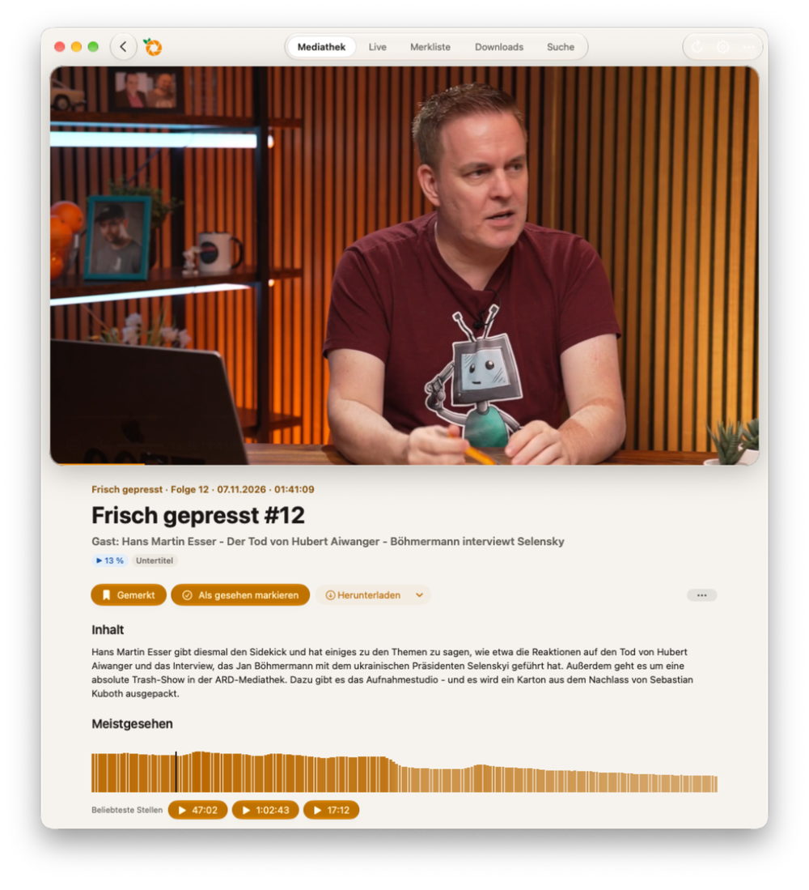
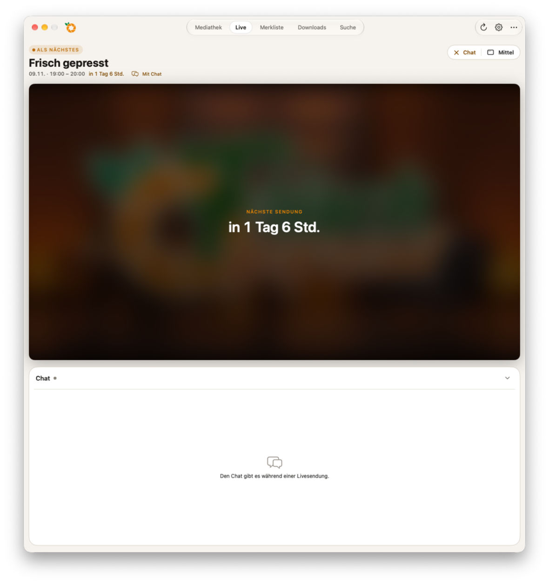
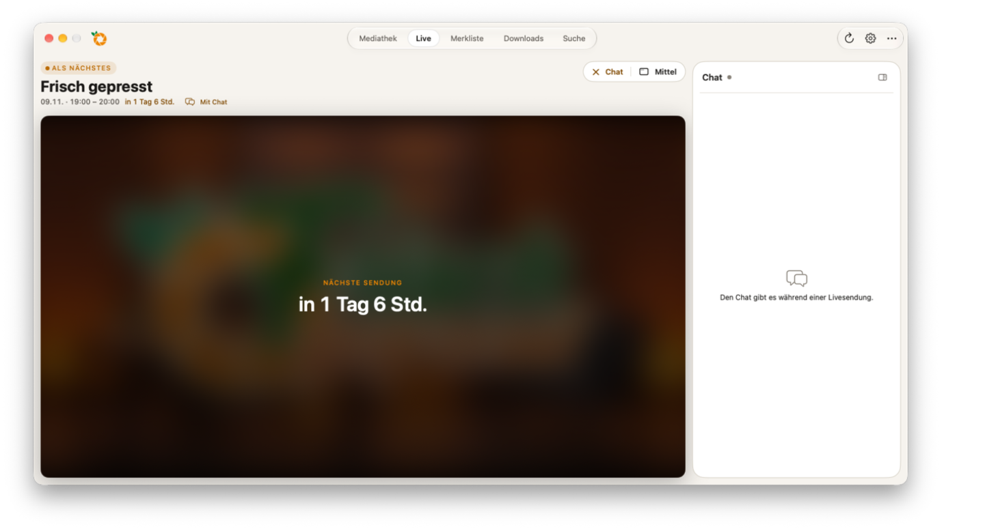
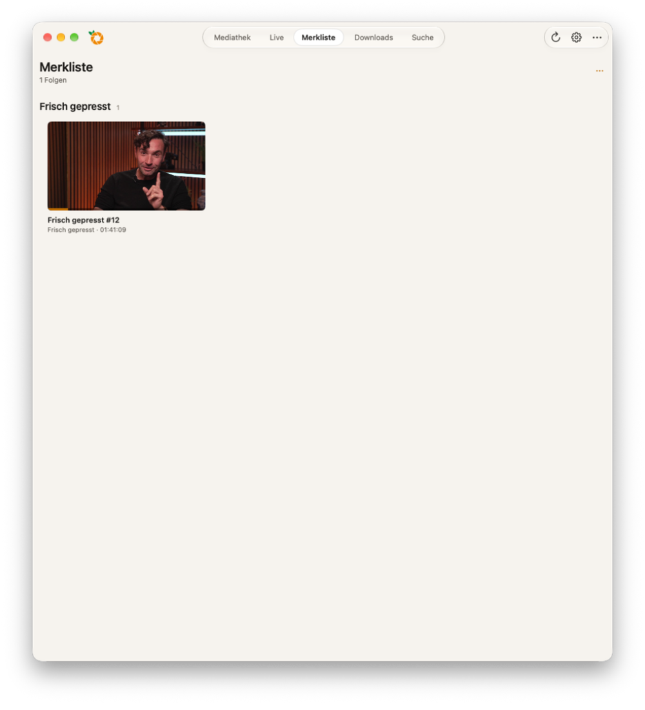
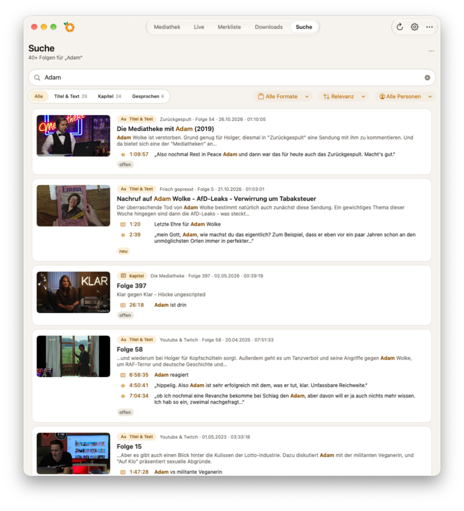
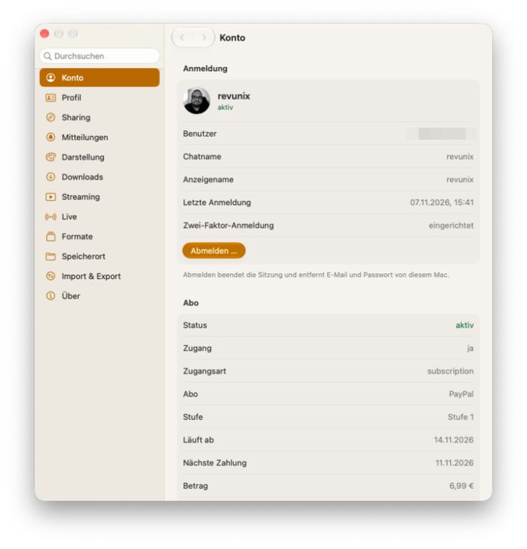
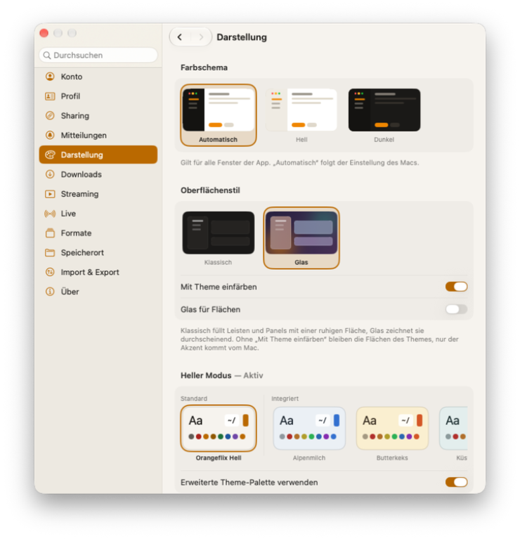

# Orangeflix for Mac

Orangeflix for Mac bringt die Mediathek und Livestreams von Orangeflix.de in eine native macOS-App. Du kannst Folgen entdecken, ansehen und herunterladen, deine Merkliste verwalten und bei Live-Sendungen den Chat verfolgen.

Die App wird privat von [Alexander (@revunix)](https://github.com/revunix) entwickelt. Sie ist **inoffiziell** und steht in keiner Verbindung zu Orangeflix.de oder dessen Betreibern. Für die Nutzung ist ein Orangeflix-Konto erforderlich; welche Inhalte verfügbar sind, hängt vom Zugang des Kontos ab.

## Funktionen

### Mediathek und Suche

- Formate und Folgen durchstöbern, neue Inhalte entdecken und begonnene Folgen in der überarbeiteten Seite **Weiterschauen** fortsetzen.
- In **Weiterschauen** zwischen allen, offenen und gesehenen Folgen filtern, mehrere Folgen auswählen und die angezeigte Gruppe gesammelt als gesehen oder ungesehen markieren.
- Folgen aus **Weiterschauen** entfernen. Die ausgeblendeten Folgen werden auf diesem Mac gespeichert und erscheinen erst wieder, wenn du sie erneut ansiehst.
- Die Regale **Neu**, **Premium**, **Weiterschauen** und **Merkliste** über **Alle anzeigen** vollständig öffnen.
- Der Hintergrund der Mediathek passt sich dezent an das aktuelle Hero-Bild an; ein weicher Verlauf verbindet Banner und Seiteninhalt.
- Folgendetails mit Beschreibung, Kapiteln und weiteren Informationen ansehen, soweit verfügbar.
- Folgen für später auf der Merkliste speichern sowie als gesehen oder ungesehen markieren.
- Titel, Beschreibungen, Kapitel und Gesprochenes durchsuchen und Ergebnisse nach Format oder Person filtern. Treffer zeigen passende Textstellen und Zeitmarken; ein Klick öffnet die Folge an der gewählten Stelle.
- Folgenbilder zeigen nach kurzem Verweilen eine Vorschau an fünf Stellen der Folge. Das funktioniert in Listen und Suchergebnissen, nicht auf der Player-Seite. Die Vorschau stellt den vorherigen Wiedergabestand anschließend wieder her.

### Wiedergabe und Live

- Folgen mit dem integrierten, auf [mpv](https://mpv.io/) basierenden Player abspielen.
- Kapitel, Untertitel, Vollbild und natives Bild-in-Bild nutzen, sofern verfügbar.
- Auf Wunsch zeigt Discord Rich Presence die aktuelle Folge oder den Livestream.
- Livestreams ansehen und den Chat unter dem Video oder daneben platzieren. Bei Sendungen mit Umfragen werden diese im Live-Bereich angezeigt.

### Downloads und Einstellungen

- Folgen herunterladen, die Download-Warteschlange verwalten und fertige Dateien im Finder anzeigen.
- Speicherort, Qualität und weitere Optionen für Downloads und Streaming einstellen.
- Das Einstellungsfenster bündelt Konto, Darstellung, Mitteilungen, Wiedergabe und Live-Chat in klar gruppierten Bereichen mit gezielter Suche.
- Discord Rich Presence und Live-Chat lassen sich mit interaktiven Vorschauen konfigurieren.
- Mit `⌘K` Formate, Bereiche und Aktionen schnell öffnen; mit `⌘L` das Live-Protokoll ein- oder ausblenden.
- Darstellung mit hellem oder dunklem Farbschema, Themes, Oberflächenstil und drei App-Symbolvarianten anpassen.
- Orangeflix auf Wunsch im Hintergrund weiterlaufen und bei der Anmeldung starten lassen. Bei geschlossenem Fenster verschwindet die App aus dem Dock; das Menüleistensymbol bietet Zugriff auf Live-Sendungen und Downloads. Mit `⌘Q` beendest du die App vollständig.
- Einstellungen sichern und wiederherstellen sowie Bibliothek und Einstellungen mit kompatiblen Dateien importieren oder exportieren.

## Screenshots

| Mediathek | Folgendetails |
|:---:|:---:|
|  |  |
| **Live mit Chat unten** | **Live mit Chat an der Seite** |
|  |  |
| **Merkliste** | **Suche** |
|  |  |
| **Kontoeinstellungen** | **Darstellung** |
|  |  |

## Installation und erster Start

Für die Nutzung benötigst du **macOS 15 oder neuer**, eine Internetverbindung und ein Orangeflix-Konto. Die bereitgestellten Release-Builds sind für Macs mit **Apple Silicon** vorgesehen.

1. Lade die aktuelle Version **1.3.1** (`Orangeflix-for-Mac.zip`) von den [GitHub Releases](https://github.com/revunix/Orangeflix-macOS/releases/latest) herunter. Die Änderungen stehen im [Changelog](CHANGELOG.md).
2. Entpacke das Archiv und verschiebe `Orangeflix.app` in den Ordner **Programme**.
3. Starte die App und melde dich mit der E-Mail-Adresse und dem Passwort deines Orangeflix-Kontos an. Wenn für dein Konto die Zwei-Faktor-Anmeldung aktiviert ist, gib zusätzlich den Code aus deiner Authenticator-App ein.

### Beim ersten Öffnen

Die Release-App ist **Ad-hoc-signiert**, aber nicht von Apple notarisiert. Deshalb kann Gatekeeper beim ersten Start eine Warnung anzeigen. Dafür brauchst du keinen Apple-Developer-Account.

1. Versuche, die App im Finder zu öffnen.
2. Falls macOS sie blockiert, öffne **Systemeinstellungen → Datenschutz & Sicherheit** und wähle bei der Meldung zu Orangeflix **Dennoch öffnen**. Bestätige die Nachfrage.

**Wichtig:** Öffne die App nur, wenn du ihrer Herkunft vertraust. Die folgenden Terminalbefehle umgehen beziehungsweise verändern Sicherheitsprüfungen; sie sind keine Bestätigung, dass ein Download sicher ist. Bei einer konkreten Malware-Warnung solltest du die App nicht auf diese Weise freigeben.

#### Alternative: Quarantäne-Attribut entfernen

Falls die Freigabe über die Systemeinstellungen nicht möglich ist, kannst du im Terminal das von macOS gesetzte Quarantäne-Attribut für diese App und ihren Inhalt entfernen:

```sh
xattr -dr com.apple.quarantine /Applications/Orangeflix.app
```

Passe den Pfad an, falls die App nicht in **Programme** liegt; bei Pfaden mit Leerzeichen setze ihn in Anführungszeichen. Danach die App erneut im Finder öffnen. Dieser Befehl entfernt nur das Quarantäne-Attribut, nicht alle Metadaten. Er signiert die App nicht und macht sie auch nicht notariert. Bei einer erneuten Installation oder einem Download kann das Attribut wieder vorhanden sein.

#### Alternative: lokal Ad-hoc signieren

Eine erneute Signierung ist normalerweise **nicht nötig**, da die Release-App bereits Ad-hoc-signiert ist. Falls die Signatur des App-Bundles beschädigt wurde, kannst du eine vertrauenswürdige Kopie lokal erneut signieren:

```sh
codesign --force --sign - --preserve-metadata=identifier,entitlements,flags,runtime /Applications/Orangeflix.app
codesign --verify --deep --strict --verbose=2 /Applications/Orangeflix.app
```

`-` erstellt eine lokale Ad-hoc-Signatur ohne Apple-Developer-Account. Die erste Zeile ersetzt die Signatur des äußeren App-Bundles und versucht, unter anderem dessen bestehende Berechtigungen zu erhalten; die zweite prüft auch eingebetteten Code. Eine lokale Signatur ist **keine** Apple-Notarisierung und umgeht Gatekeeper nicht automatisch. Beschädigte eingebettete Komponenten werden damit nicht repariert: Schlägt die Prüfung fehl, lade eine unveränderte Kopie aus den Releases herunter. Durch eine Neusignierung können unter anderem Schlüsselbundzugriff oder Updates beeinträchtigt werden; im Zweifel ebenfalls das Original erneut installieren.

## Bedienung

Über die Navigation im Hauptfenster erreichst du Mediathek, Live, **Weiterschauen**, Merkliste, Downloads und Suche. Ein Klick auf ein Suchergebnis öffnet die Folgenseite; ein Klick auf eine Zeitmarke startet die Wiedergabe an dieser Stelle. Bleib kurz mit dem Zeiger auf einem Folgenbild, um die Vorschau mit fünf Abschnitten zu laden.

Weitere Aktionen findest du per Rechtsklick auf eine Folge oder im Menü **Aktionen**. Dort kannst du sie als gesehen oder ungesehen markieren. In **Weiterschauen** kannst du einzelne Folgen oder die gefilterte Gruppe gesammelt markieren. Mehrere Folgen werden nacheinander gespeichert; die App zeigt den Fortschritt an. Eine Folge aus **Weiterschauen** zu entfernen blendet sie auf diesem Mac aus. In den Einstellungen kannst du unter anderem Benachrichtigungsformate, Hintergrundbetrieb, Download-Ordner und Darstellung ändern.

| Kurzbefehl | Aktion |
|:---|:---|
| `⌘1` bis `⌘8` | Navigationsbereiche öffnen |
| `⌘F` | Suche öffnen |
| `⌘L` | Protokoll ein- oder ausblenden |
| `⌘K` | Schnellwechsel für Formate, Bereiche und Aktionen öffnen |
| `F` im Player | Vollbild umschalten |
| `C` im Player | Untertitel ein- oder ausblenden |

## Datenschutz und lokale Daten

Das Passwort wird im macOS-Schlüsselbund gespeichert. Die E-Mail-Adresse und Sitzungstokens liegen lokal unter `~/Library/Application Support/Orangeflix/credentials.json`; die Datei ist für den eigenen Benutzer geschützt. Beim Abmelden werden die gespeicherten Zugangsdaten entfernt. Eine Sicherung der App-Einstellungen enthält keine Anmeldung.

## Für Entwickler

### Voraussetzungen

- macOS 15 oder neuer
- Xcode mit macOS-SDK
- [Homebrew](https://brew.sh/) und mpv zum Erzeugen der eingebetteten libmpv-Bibliotheken

### Bauen

1. Das Repository klonen, die Abhängigkeit installieren und die lokalen libmpv-Dateien erzeugen:

   ```sh
   git clone https://github.com/revunix/Orangeflix-macOS.git
   cd Orangeflix-macOS
   brew install mpv
   scripts/vendor-libmpv.sh
   ```

2. `Orangeflix.xcodeproj` in Xcode öffnen.
3. Das Scheme **Orangeflix** und als Ziel **My Mac** auswählen.
4. Mit **⌘R** bauen und starten oder mit **⌘B** nur bauen.

Die erzeugten libmpv-Dateien unter `Vendor/libmpv` sind maschinenspezifisch und werden nicht mit Git versioniert. Das Skript ersetzt diesen Ordner und erstellt ihn aus der lokalen Homebrew-Installation neu. Die Bibliotheken müssen zur Architektur des Builds passen.

### Projektstruktur

- `Orangeflix/Features/` – Oberflächen und Logik für Mediathek, Wiedergabe, Live, Downloads und Einstellungen.
- `Orangeflix/Core/` – API, lokale Speicherung, Live-Chat und Download-Implementierung.
- `Tests/OrangeflixLogicTests/` – Tests für ausgewählte, von der Oberfläche unabhängige Logik.
- `scripts/vendor-libmpv.sh` – bereitet libmpv und seine Abhängigkeiten für das App-Bundle vor.
- `.github/workflows/release.yml` – Workflow für Release-Build und Veröffentlichung.

### Logiktests

Das Swift-Package enthält Tests für ausgewählte reine Logik ohne SwiftUI, AppKit oder mpv. Es baut nicht die vollständige App:

```sh
swift test
```

## Updates

Die App verwendet [Sparkle](https://sparkle-project.org/) für Update-Prüfung,
Download, Signaturprüfung und Installation. **Allgemein → Nach Updates suchen …**
oder **Einstellungen → Allgemein → Softwareupdate** öffnet die Update-Prüfung; Sparkle
zeigt die zum Release gehörenden Versionshinweise an.

Unter **Einstellungen → Allgemein → Softwareupdate** kannst du automatische
Update-Prüfungen ein- oder ausschalten und das Intervall auf täglich,
wöchentlich oder monatlich setzen. Die manuelle Suche ist außerdem im Menü
**Orangeflix** neben dem Apple-Menü und im Menüleistensymbol verfügbar, wenn
Orangeflix im Hintergrund weiterläuft.

Updates werden aus GitHub Releases bezogen. Dafür muss das Repository öffentlich
sein und ein Release die von Sparkle signierte `appcast.xml`, ein signiertes
App-Archiv und die Versionshinweise enthalten. Der private EdDSA-Schlüssel darf
nicht in dieses Repository gelangen.

**Update bleibt nach dem Download hängen:** Version 1.1.1 fehlt die für die
App-Sandbox benötigte Sparkle-Installationskonfiguration. Wenn du noch 1.1.1
verwendest, installiere Version 1.2.2 einmal manuell aus den
[GitHub Releases](https://github.com/revunix/Orangeflix-macOS/releases/latest),
indem du die alte App durch die neue ersetzt. Die lokalen Daten liegen getrennt
vom App-Bundle; sichere sie vorsichtshalber vor dem Austausch. Eventuell musst
du dich erneut anmelden. Danach sollten Updates über die App funktionieren.

### Release veröffentlichen

Unter **Actions → Publish macOS release → Run workflow** eine Version im Format
`X.Y.Z` und den Changelog eingeben. Der Workflow baut die App mit Ad-hoc-
Signierung, signiert das Update-Archiv mit Sparkle, erzeugt `appcast.xml` und
veröffentlicht Release und Versionshinweise zusammen.

Dafür muss im Repository unter **Settings → Secrets and variables → Actions**
das Secret `SPARKLE_EDDSA_PRIVATE_KEY` (base64-kodierter privater Sparkle-
Schlüssel) hinterlegt sein. Der Workflow benötigt einen geeigneten macOS-Runner
mit dem Label `xcode-27`, aber keinen Apple-Account. Vor dem Verpacken prüft
`scripts/verify-updater.py` die Sparkle-Konfiguration im App-Bundle.

Sparkle prüft heruntergeladene Updates mit der EdDSA-Signatur. Weitere Hinweise
zu Signaturen und Verteilung gibt es in der [Sparkle-Dokumentation](https://sparkle-project.org/documentation/).

## Lizenz

Der Quelltext steht unter der [MIT-Lizenz](LICENSE).

## Danksagung und Quellen

Vielen Dank an alle, deren Projekte, Dokumentationen und Quellen die Entwicklung dieser App ermöglicht haben. Besonderer Dank gilt:

- [mpv](https://mpv.io/) für den Player und die verwendeten Bibliotheken.
- [Sparkle](https://sparkle-project.org/) für das Update-Framework.
- Den Bereitstellern der [Massengeschmack-API und ihrer Dokumentation](https://massengeschmack.tv/api/v3/docs#description/introduction), die diese App verwendet.

Die App ist ein unabhängiges, inoffizielles Projekt und steht in keiner Verbindung zu Orangeflix oder dessen Betreibern.
